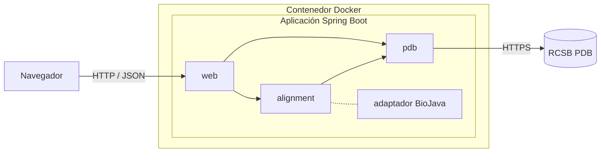

# protein-aligner


Aplicación web para comparar dos proteínas mediante **alineamiento global**
(Needleman-Wunsch) y **alineamiento local** (Smith-Waterman). Las proteínas se
eligen ingresando su código PDB, y los algoritmos los resuelve
[BioJava](https://biojava.org/): el foco del proyecto no es reimplementarlos,
sino usarlos bien, mostrar los resultados con claridad y analizar casos donde
ambos enfoques dan respuestas distintas.

Trabajo final de la materia Bioinformática (UNAJ).

## Contenido

- [Estado del proyecto](#estado-del-proyecto)
- [Qué hace](#qué-hace)
- [Global vs. local](#global-vs-local)
- [Cómo ejecutarlo](#cómo-ejecutarlo)
- [Arquitectura](#arquitectura)
- [Estructura del proyecto](#estructura-del-proyecto)
- [Decisiones de diseño](#decisiones-de-diseño)
- [Tests y calidad](#tests-y-calidad)
- [Limitaciones conocidas](#limitaciones-conocidas)
- [Licencia](#licencia)

## Estado del proyecto

En desarrollo, trabajado por sprints.

- [x] Base del proyecto: módulos, test de arquitectura, CI, endpoint de salud y Docker
- [x] Modelo de dominio: código PDB validado y entidades de una entrada
- [ ] Obtención de secuencias desde RCSB PDB
- [ ] Alineamiento global (Needleman-Wunsch)
- [ ] Alineamiento local (Smith-Waterman)
- [ ] Front web
- [ ] Parámetros: matriz de sustitución y penalización de gaps
- [ ] Análisis de ejemplos y presentación

## Qué hace

1. Se ingresa el código PDB de cada proteína (por ejemplo, `4HHB`).
2. La aplicación consulta la base de datos [RCSB PDB](https://www.rcsb.org/) y
   obtiene las secuencias. Si la entrada tiene varias entidades (como la
   hemoglobina, con cadenas alfa y beta), se elige cuál alinear.
3. Se elige el algoritmo: global o local.
4. Se muestra el alineamiento con su score, porcentaje de identidad, similitud
   y cantidad de gaps. En el alineamiento local, además, las posiciones del
   fragmento alineado.

<!-- Agregar una captura del front cuando exista -->

## Global vs. local

| | Needleman-Wunsch (global) | Smith-Waterman (local) |
| --- | --- | --- |
| Qué alinea | Las dos secuencias completas, de punta a punta | Solo la mejor región en común |
| Cuándo conviene | Proteínas homólogas de largo parecido | Proteínas que comparten un dominio o un motivo |
| Resultado | Un alineamiento que cubre todo | Un fragmento, con sus posiciones de inicio y fin |
| Técnica | Programación dinámica sobre una matriz de n x m | Igual, pero los valores negativos se reemplazan por cero |

Ambos usan una matriz de sustitución (como BLOSUM62) y penalizaciones de gap.
Cambiar cualquiera de ellos cambia el score, por lo que los scores solo son
comparables bajo los mismos parámetros.

## Cómo ejecutarlo

### Con Docker (recomendado)

Solo se necesita Docker: no hace falta instalar Java ni Gradle.

```
git clone https://github.com/santiagolovisotto/protein-aligner.git
cd protein-aligner
docker compose up --build
```

La aplicación queda en http://localhost:8080. Para verificar que arrancó,
http://localhost:8080/actuator/health debe responder `{"status":"UP"}`.

Si el puerto 8080 está ocupado, copiar `.env.example` como `.env`, cambiar
`APP_PORT` y volver a levantar.

El contenedor necesita salida a internet, porque las secuencias se consultan a
RCSB PDB.

### Sin Docker

Requiere Java 21.

```
./gradlew bootRun
```

## Arquitectura

Monolito modular: una sola aplicación Spring Boot con tres módulos y reglas
claras de dependencia.



| Módulo | Responsabilidad |
| --- | --- |
| `pdb` | Dado un código PDB, obtiene las secuencias de sus entidades. Es el único módulo que sale a internet. |
| `alignment` | Compara dos secuencias con el algoritmo elegido. BioJava vive solo en `alignment.biojava`. |
| `web` | API REST y front estático. |

## Estructura del proyecto

```
protein-aligner/
├── .github/workflows/ci.yml        CI: compila y corre los tests
├── src/
│   ├── main/java/com/santiagolovisotto/proteinaligner/
│   │   ├── pdb/                    acceso a RCSB PDB
│   │   ├── alignment/              alineamiento (adaptador BioJava en alignment.biojava)
│   │   └── web/                    API REST
│   ├── main/resources/static/      front web
│   └── test/java/...               tests por módulo y test de arquitectura
├── Dockerfile                      imagen en dos etapas (compila y ejecuta)
├── docker-compose.yml              levanta la aplicación con un comando
└── .env.example                    puerto configurable
```

## Decisiones de diseño

- **No reinventar los algoritmos.** Se usa BioJava en lugar de implementar
  Needleman-Wunsch y Smith-Waterman a mano, y se lo aísla en un único paquete
  para que el resto del proyecto no dependa de la librería.
- **Sin base de datos propia.** Las secuencias vienen de RCSB PDB y no hay datos
  que persistir; agregar una base sería complejidad sin función.
- **Dependencias verificadas por test.** Un test de arquitectura (ArchUnit)
  hace fallar el build si un módulo rompe las reglas, por ejemplo si `pdb`
  empezara a depender de `web` o si se usara BioJava fuera de su adaptador.
- **La red queda detrás de una interfaz.** El acceso a RCSB está definido como
  contrato, de modo que los tests y el CI usan una versión simulada y nunca
  dependen de internet.
- **Un solo comando para levantarlo.** Docker Compose con un único servicio,
  puerto configurable y control de salud.

## Tests y calidad

```
./gradlew test
```

Cada push y pull request a `main` dispara el CI en GitHub Actions: compila,
corre los tests unitarios y el test de arquitectura.

## Limitaciones conocidas

- Se alinean proteínas: las entidades que son ADN o ARN se detectan por
  heurística y se rechazan.
- Hay un tope de longitud por secuencia, porque ambos algoritmos consumen
  memoria proporcional a n x m.
- Depende de que RCSB PDB esté disponible.

## Licencia

GPL-V3.0