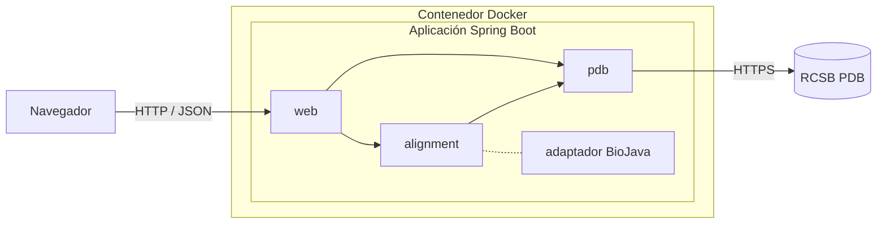

# protein-aligner


Aplicación web para comparar dos proteínas mediante **alineamiento global**
(Needleman-Wunsch) y **alineamiento local** (Smith-Waterman). Las proteínas se
eligen ingresando su código PDB (cualquier entrada del Protein Data Bank), y
los algoritmos los resuelve [BioJava](https://biojava.org/): el foco del
proyecto no es reimplementarlos, sino usarlos bien, mostrar los resultados con
claridad y analizar casos donde ambos enfoques dan respuestas distintas.

Trabajo final de la materia Bioinformática (UNAJ).

<!-- Capturas: guardarlas en docs/ y descomentar


-->

## Contenido

- [Estado del proyecto](#estado-del-proyecto)
- [Qué hace](#qué-hace)
- [Global vs. local](#global-vs-local)
- [Cómo leer el resultado](#cómo-leer-el-resultado)
- [Cómo ejecutarlo](#cómo-ejecutarlo)
- [API](#api)
- [Arquitectura](#arquitectura)
- [Estructura del proyecto](#estructura-del-proyecto)
- [Decisiones de diseño](#decisiones-de-diseño)
- [Tests y verificación](#tests-y-verificación)
- [Limitaciones conocidas](#limitaciones-conocidas)
- [Licencia](#licencia)

## Estado del proyecto

- [x] Base del proyecto: módulos, test de arquitectura, CI, endpoint de salud y Docker
- [x] Obtención de secuencias desde RCSB PDB, con caché en memoria
- [x] Alineamiento global (Needleman-Wunsch)
- [x] Alineamiento local (Smith-Waterman)
- [x] Front web con visualizaciones
- [ ] Parámetros desde el front: la API ya acepta penalizaciones de gap; el front usa los valores por defecto
- [ ] Análisis de ejemplos y presentación

## Qué hace

1. Se ingresa el código PDB de cada proteína (por ejemplo, `4HHB`) o se elige
   uno de los ejemplos.
2. La aplicación consulta [RCSB PDB](https://www.rcsb.org/) y obtiene las
   secuencias. Si la entrada tiene varias entidades (como la hemoglobina, con
   cadenas alfa y beta), se elige cuál alinear. Las entidades de ADN o ARN se
   descartan.
3. Se elige el algoritmo: global o local.
4. Se muestra el resultado con tres visualizaciones: la región alineada en
   cada proteína, el perfil de conservación a lo largo del alineamiento y el
   alineamiento con cada columna resaltada (idéntica, similar, sustitución o gap).

Ejemplo, hemoglobina humana alfa (141 aa) contra beta (146 aa), con BLOSUM62:

| | Score | Identidad | Región alineada |
| --- | --- | --- | --- |
| Global | 281 | 64 de 148 (43,2 %) | 1-141 y 1-146 |
| Local | 288 | 63 de 145 | 2-140 y 3-145 |

## Global vs. local

| | Needleman-Wunsch (global) | Smith-Waterman (local) |
| --- | --- | --- |
| Qué alinea | Las dos secuencias completas, de punta a punta | Solo la mejor región en común |
| Cuándo conviene | Proteínas homólogas de largo parecido | Proteínas que comparten un dominio o un motivo |
| Resultado | Un alineamiento que cubre todo | Un fragmento, con sus posiciones de inicio y fin |
| Técnica | Programación dinámica sobre una matriz de n x m | Igual, pero los valores negativos se reemplazan por cero |

Un caso calculado a mano, incluido en los tests: `WWWACDEFGHWWW` contra
`PPPACDEFGHGGG`. El dominio común `ACDEFGH` suma 44 con BLOSUM62. El local lo
encuentra y descarta los extremos (score 44); el global está obligado a
alinear los extremos y baja a 26.

## Cómo leer el resultado

- **Score:** suma de los valores de la matriz de sustitución (BLOSUM62) para
  cada par alineado, menos las penalizaciones de gap. Solo es comparable entre
  alineamientos hechos con la misma matriz y los mismos parámetros.
- **Identidad:** columnas con el mismo aminoácido en las dos secuencias.
- **Similitud:** identidades más sustituciones con score positivo en la matriz.
- **Gaps:** columnas en las que una de las secuencias tiene un hueco.
- Los porcentajes se calculan sobre el largo del alineamiento (columnas, con
  los gaps incluidos).
- **Penalización de gap** (valores por defecto de BioJava, verificados con
  tests): un gap de largo n cuesta 10 + n.

## Cómo ejecutarlo

### Con Docker (recomendado)

Solo se necesita Docker: no hace falta instalar Java ni Gradle.

```
git clone https://github.com/santiagolovisotto/protein-aligner.git
cd protein-aligner
docker compose up --build
```

La aplicación queda en http://localhost:8080. Para verificar que arrancó,
http://localhost:8080/actuator/health debe responder `{"status":"UP"}`.

Si el puerto 8080 está ocupado, copiar `.env.example` como `.env`, cambiar
`APP_PORT` y volver a levantar.

El contenedor necesita salida a internet, porque las secuencias se consultan a
RCSB PDB.

### Sin Docker

Requiere Java 21.

```
./gradlew bootRun
```

## API

| Método y ruta | Qué hace |
| --- | --- |
| `GET /api/pdb/{codigo}` | Lista las entidades proteicas de una entrada PDB. |
| `POST /api/align` | Alinea dos entidades. |
| `GET /actuator/health` | Estado de la aplicación. |

```
curl -X POST http://localhost:8080/api/align \
  -H 'Content-Type: application/json' \
  -d '{"query":{"code":"4HHB","entityId":1},"target":{"code":"4HHB","entityId":2},"type":"GLOBAL"}'
```

`type` puede ser `GLOBAL` o `LOCAL`. Opcionalmente se pueden indicar `matrix`,
`gapOpen` y `gapExtension`. Los errores se devuelven en formato `ProblemDetail`:
400 (solicitud inválida), 404 (entrada o entidad inexistente), 422 (sin
proteínas, proteína demasiado larga o sin región en común) y 503 (RCSB no
disponible).

## Arquitectura

Monolito modular: una sola aplicación Spring Boot con tres módulos y reglas
claras de dependencia.



| Módulo | Responsabilidad |
| --- | --- |
| `pdb` | Dado un código PDB, obtiene las secuencias de sus entidades. Es el único módulo que sale a internet. |
| `alignment` | Compara dos secuencias con el algoritmo elegido. BioJava vive solo en `alignment.biojava`. |
| `web` | API REST y front estático. |

## Estructura del proyecto

```
protein-aligner/
├── .github/workflows/ci.yml        CI: compila y corre los tests
├── src/
│   ├── main/java/com/santiagolovisotto/proteinaligner/
│   │   ├── pdb/                    acceso a RCSB PDB
│   │   ├── alignment/              alineamiento (adaptador BioJava en alignment.biojava)
│   │   └── web/                    API REST
│   ├── main/resources/static/      front web (un solo archivo)
│   └── test/java/...               tests por módulo y test de arquitectura
├── Dockerfile                      imagen en dos etapas (compila y ejecuta)
├── docker-compose.yml              levanta la aplicación con un comando
└── .env.example                    puerto configurable
```

## Decisiones de diseño

- **No reinventar los algoritmos.** Se usa BioJava en lugar de implementar
  Needleman-Wunsch y Smith-Waterman a mano, y se lo aísla en un único paquete
  para que el resto del proyecto no dependa de la librería.
- **Sin base de datos propia.** Las secuencias vienen de RCSB PDB y no hay datos
  que persistir; agregar una base sería complejidad sin función.
- **Dependencias verificadas por test.** Un test de arquitectura (ArchUnit)
  hace fallar el build si un módulo rompe las reglas, por ejemplo si `pdb`
  empezara a depender de `web` o si se usara BioJava fuera de su adaptador.
- **La red queda detrás de una interfaz.** El acceso a RCSB está definido como
  contrato, de modo que los tests y el CI usan una versión simulada y nunca
  dependen de internet.
- **Un servicio externo que no sigue buenas prácticas HTTP.** RCSB responde 200
  incluso para entradas inexistentes, con un mensaje de texto en el cuerpo; el
  adaptador reconoce esos mensajes.
- **Un front sin dependencias.** Una sola página en HTML y JavaScript, con los
  gráficos dibujados en SVG, servida por la misma aplicación.
- **Un solo comando para levantarlo.** Docker Compose con un único servicio,
  puerto configurable y control de salud.

## Tests y verificación

```
./gradlew test
```

- Los scores se verifican contra casos calculados a mano con BLOSUM62.
- Un test contrasta las identidades y similitudes propias con los contadores
  de BioJava.
- Los tests de BioJava documentan su comportamiento (por ejemplo, el costo de
  un gap).
- El acceso a RCSB se prueba con un servidor HTTP local, sin internet.

Cada push y pull request a `main` dispara el CI en GitHub Actions: compila,
corre los tests y el test de arquitectura.

## Limitaciones conocidas

- Solo se alinean proteínas: las entidades de ADN o ARN se detectan por
  heurística (secuencias de solo A, C, G, T, U, N) y se rechazan.
- Hay un tope de 2000 residuos por proteína, configurable, porque ambos
  algoritmos consumen memoria proporcional a n x m. Alinear dos proteínas de
  1372 residuos tardó cerca de 1 segundo.
- Solo está disponible la matriz BLOSUM62.
- Depende de que RCSB PDB esté disponible.

## Licencia

GPL-3.0